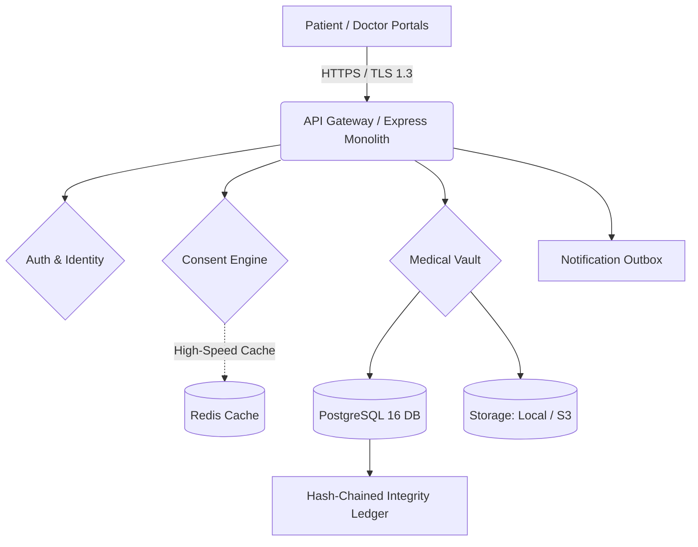

### 1. System Architecture Diagram Content — Chapter 4

**Academic Explanation**
The MediLocker system architecture follows a centralized, zero-trust cloud model implemented as a monolithic backend service designed for eventual microservices decomposition. The core application logic resides in a Node.js/Express service that processes HTTPS requests from modular React web portals. To enforce data security, all uploaded medical documents undergo AES-256-GCM envelope encryption before being persisted to the storage layer, which abstracts either local disk or cloud object storage. Cryptographic integrity is maintained by computing SHA-256 hashes for all records and anchoring them in an append-only, hash-chained PostgreSQL database ledger, ensuring tamper-evident storage. To achieve high performance for critical operations, granular patient consent rules are cached in an in-memory datastore (Redis), reducing authorization latency. 

**Mermaid Architecture Diagram**

**Figure Title and Caption**
*Figure 4.1: MediLocker System Architecture Topology.*
*Caption: High-level data flow depicting the interaction between the React frontend portals and the Express backend, highlighting the integration of Redis for consent caching and PostgreSQL for hash-chained ledger integrity.*

---

### 2. Application Screenshot Captions — Chapter 6

**1. Patient Dashboard and Consent Manager**
* **Figure [X.1]**: Patient Dashboard Overview
* **Caption**: *Figure X.1: Patient dashboard displaying active consent grants and granular category-level controls.*
* **Description**: This screenshot demonstrates the primary patient interface where users can view their active consent grants. It highlights the granular nature of the platform, showing how a patient can selectively allow or block specific medical record categories for individual healthcare providers.

**2. Doctor's Prescription Interface**
* **Figure [X.2]**: Digital Prescription Generation and ECDSA Signing
* **Caption**: *Figure X.2: Doctor's interface for generating structured prescriptions with cryptographic digital signatures.*
* **Description**: This screen illustrates the prescription generation workflow. It captures the moment a verified doctor cryptographically signs a prescription using a browser-generated, non-extractable ECDSA P-256 private key, ensuring non-repudiation.

**3. Break-Glass Emergency Access**
* **Figure [X.3]**: Emergency Access Dual-Verification Prompt
* **Caption**: *Figure X.3: The 'Break-Glass' emergency override module requiring secondary OTP verification.*
* **Description**: This screenshot shows the emergency access request portal. It demonstrates the dual-verification security measure, where a requesting emergency physician must obtain OTP approval from a hospital administrator before temporary, 4-hour access is granted.

---

### 3. Corrected User-Role Paragraph

**Corrected Paragraph:**
The MediLocker platform implements a rigorous Role-Based Access Control (RBAC) mechanism supporting five distinct authenticated user roles alongside one unauthenticated public interface. The authenticated roles comprise the Patient (managing vaults and consents), the Doctor (uploading records and signing prescriptions), the Hospital Administrator (managing staff and API integrations), the Platform Administrator (overseeing system health and audit logs), and the Emergency Physician (utilizing the Break-Glass module). Furthermore, the system exposes a public, unauthenticated verifier portal (`/verify`) that allows external entities, such as pharmacies, to cryptographically validate the authenticity of digital prescriptions without requiring a registered account.

---

### 4. Corrected Chapter 4 Headings

**Revised Structure for Chapter 4:**

* **SDLC model selection and justification** 
  * *(Map existing content discussing the Agile methodology and the six delivery phases here).*
* **4.1 Existing System**
  * *(Map existing content detailing isolated Hospital Management Systems, plaintext databases, and paper handoffs here).*
* **4.2 Limitations of Existing System**
  * *(Map existing content listing the 5 limitations: security vulnerability, no patient control, tampering risks, emergency blindspots, and lack of an audit trail here).*
* **4.3 Proposed System**
  * *(Map existing content detailing the React frontend, Express backend, PostgreSQL, AES-256-GCM encryption, Redis caching, and the architectural diagram here).*
* **4.4 Problem Definition / Title**
  * *(Map the existing Project Title and Problem Statement text here).*

---

### 5. Revised Certificate Text

**CERTIFICATE**
*(Requires approval from Project Guide/Department)*

This is to certify that the project report entitled **"MediLocker — Secure Cloud-Based Digital Medical Record Management Platform"** submitted by:

* **Dnyaneshwari Ghorpade**
* **Aastha Chaudhari**
* **Soham Sapkal**

is a bonafide work carried out by them under my supervision and guidance in partial fulfillment for the Software Project Management Laboratory requirement.

**Date:** ___________________
**Place:** __________________

___________________________                 ___________________________
**(Name of the Guide)**                     **(Name of the HOD)**
Project Guide                               Head of Department
Department of Computer Engineering          Department of Computer Engineering

---

### 6. Corrections to Existing Claims

**Test Counts:**
*Replacement Sentence:* "The system's reliability is verified through 77 dedicated integration tests covering security workflows, alongside a separate automated smoke testing script that confirms 78 out of 78 API routes return successful, non-5xx responses."

**Performance Targets:**
*Replacement Sentence:* "Performance benchmarking indicates that while consent token evaluation meets the sub-10ms SLA during a Redis cache hit, cold-cache database evaluations currently average ~90ms, necessitating future co-location of the database to strictly meet the performance targets."

**Implemented vs. Planned Architecture:**
*Replacement Sentence:* "While the target architecture designs for AWS S3 object storage, AWS KMS hardware key management, an Apache Kafka event bus, and a Hyperledger Fabric distributed ledger, the current verifiable implementation utilizes local disk storage, local environment master keys, a node-cron notification outbox, and a robust hash-chained PostgreSQL table to achieve tamper-evident immutability."

**Regulatory Compliance Evidence:**
*Replacement Sentence:* "The platform aligns with the data protection principles of the India DPDP Act 2023 through granular consent revocation, salted Aadhaar hashing, and immutable audit trails; however, formal integration with the UIDAI and ABDM production networks remains a planned extension pending institutional accreditation."
